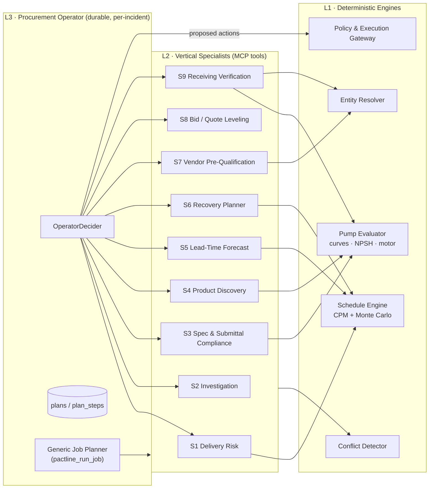

# 03 — Pactline Agent Suite Specification

> **Role of this doc:** the authoritative catalogue of every agent, specialist, and deterministic engine in Pactline: what each one takes in, what it returns, where it is deterministic vs. model-driven, how it scores confidence, and when it hands off to a human.
> **Status:** Proposed — November 27, 2026. Supersedes the 3-specialist MVP in plan doc §16 where they conflict. Nothing here is built unless the [checklist](checklist.md) says so.
> **Governing rule:** *The model reads and proposes. Deterministic code judges, computes and authorizes. Humans approve anything binding.*

---

## 1. Why a suite, and how it is organised

Track 03 asks for "a suite that covers as much of the procurement workflow as possible, without trading away depth", where "each agent's output feeds the next". Track 01 asks for a generalist that "keeps the whole job in view and calls on vertical agents only when a step needs them".

Pactline answers both with **three layers**:

| Layer | What lives here | Track |
| --- | --- | --- |
| **L1 — Deterministic engines** | Schedule engine (CPM + Monte Carlo), Pump compliance evaluator, Policy & execution gateway, Entity resolver, Conflict detector | Foundation for both |
| **L2 — Vertical specialists** (MCP tools) | 9 specialists, each callable alone by Amber | **Track 03 (primary)** |
| **L3 — Procurement Operator** | Long-running incident owner + plan-as-data + generic job planner over the tool registry | **Track 01 (supporting)** |

Every specialist is (a) an MCP tool, (b) usable standalone without the operator, (c) returns the shared `SpecialistResult` envelope (§3), and (d) never writes canonical world state — only the operator/runtime does, through the gateway.



---

## 2. Suite at a glance

| # | Specialist (MCP tool) | Track 03 listed? | Answers the question | Deterministic core | Model's job | Tier |
| --- | --- | --- | --- | --- | --- | --- |
| S1 | `pactline_assess_delivery_risk` | Schedule & delivery risk | "Which late items will really hold up the project, and how likely?" | CPM, float, Monte Carlo P(on-time), criticality index | none (explanation prose only, grounded) | **Must** |
| S2 | `pactline_investigate` | (ours) | "Why is it late, what do we actually know, what's missing?" | Bi-temporal fact diff, freshness rules | Reconcile messages, label hypotheses w/ confidence | **Must** |
| S3 | `pactline_check_submittal` | Spec & submittal compliance | "Does this exact pump configuration comply, line by line, citing both documents?" | Curve interpolation, ISO 9906 tolerance, NPSH, motor non-overload, typed predicates | Extract spec clauses + submittal values + digitize curves, all with page/bbox | **Must (crown jewel)** |
| S4 | `pactline_find_equivalents` | Product discovery | "What real alternatives exist and why does each match or fall short?" | Affinity-law trim, POR check, fit score, runs S3 on each | Read catalog sheets into configurations | **Must** |
| S5 | `pactline_forecast_lead_time` | Lead time prediction | "When will it realistically arrive — as an honest range?" | Log-normal/quantile model + split-conformal calibration, vendor slip history | Extract quoted lead time basis ("ARO" vs "after approval") | **Must** |
| S6 | `pactline_plan_recovery` | (ours; extends risk) | "What are the feasible recovery options, ranked, and what do they need?" | Hard-constraint filter, counterfactual Monte Carlo ΔP(on-time), cost delta | Narrative + RFI/email drafts (grounding-validated) | **Must** |
| S7 | `pactline_prequalify_vendor` | Vendor pre-qualification | "Is this vendor safe to trust with a critical job?" | Rule scorecard PASS/FLAG/FAIL/UNKNOWN, entity-match threshold | Summarise public records into facts with sources | **Should** |
| S8 | `pactline_level_quotes` | Bid leveling | "Do these quotes cover the same scope; what's excluded; which is cheapest *normalised*?" | Fixed exclusion taxonomy, plug values, deterministic totals | Extract line items / exclusions / qualifications | **Should** |
| S9 | `pactline_verify_receipt` | (Track-02 flavour) | "Is the pump that arrived the one we ordered and approved?" | Field-by-field match vs. PO + approved submittal, tolerance | Read nameplate photo / delivery note (3-run agreement) | **Should** |
| — | `pactline_discover_vendors` | Vendor discovery | "Who else could supply this, from public sources?" | Entity resolution, source-required filter | Read rep locator / directory pages | Stretch |
| — | Private deployment profile | Private deployment | "Can all of this run offline?" | Same engines | Swap gateway URL → local open-weight models | Stretch |

**Operator-level MCP tools** (Track 01): `pactline_get_incident`, `pactline_explain_decision`, `pactline_submit_approval`, `pactline_ingest_event`, `pactline_ingest_document` (long-running task), `pactline_run_job` (generic planner).

> **Why nine and not three:** plan doc §16 recommended "three genuinely distinct model-driven specialists". That remains true for *model-driven* depth. The additional specialists are mostly deterministic engines we already need (schedule, compliance evaluator) given an MCP face, plus three cheap-but-high-signal additions (lead-time conformal, pre-qual on public records, nameplate verification). Each one is in the suite only if it passes the depth bar in §5.

---

## 3. Shared data contract (build first)

One envelope for every specialist. Track 03 scores "shared data formats so one specialist's output can feed another's input cleanly" — this is where that is won. Defined once as Zod in `packages/domain/src/contracts.ts`; MCP `outputSchema` is generated from it.

```ts
// SpecialistResult<T> — returned by every L2 tool
{
  specialist: "spec_compliance",          // stable id
  version: "1.0.0",
  run_id: "run_01J…",                     // ULID
  case_id: "INC-0007" | null,             // incident if called by operator
  idempotency_key: "sha256(canonical inputs + specialist version)",
  status: "OK" | "PARTIAL" | "ABSTAINED" | "NEEDS_HUMAN" | "ERROR",
  result: T,                              // typed payload per specialist
  findings: Finding[],
  confidence: Confidence,
  evidence: SourceRef[],
  handoff: HumanHandoff | null,
  next_suggested: { specialist: string; reason: string; input_patch: object }[],
  assumptions: string[],                  // e.g. "water at 7°C, SG 1.0"
  input_versions: StatePin,               // requirement_rev, config_rev, schedule_rev …
  generated_at: string,                   // from injected Clock
  model_usage: { model: string; tokens_in: number; tokens_out: number; usd: number; ms: number }[]
}

// SourceRef — every claim points to at least one
{ ref_id, kind: "spec_section"|"submittal"|"datasheet"|"curve"|"quote"|"po"|"email"
          |"public_registry"|"market_report"|"price_index"|"standard"|"photo"|"derived",
  uri, title, publisher, retrieved_at, content_hash,
  locator: { page?, bbox?: [x0,y0,x1,y1], section?, row?, json_path? },
  excerpt,                                 // ≤300 chars VERBATIM — validated
  trust_tier: "primary"|"secondary"|"vendor_claim"|"derived"|"synthetic" }

// Confidence — never a bare float
{ score: 0..1,
  method: "deterministic"|"conformal"|"agreement"|"evidence_coverage"|"heuristic",
  tier: "CERTAIN"|"PROBABLE"|"POSSIBLE"|"INSUFFICIENT_EVIDENCE",
  interval?: { lo, hi, unit, coverage },   // numeric outputs
  evidence_coverage: 0..1,                 // required facts with ≥1 primary SourceRef
  reason: "2 of 3 extractions agree; curve digitized (RMS 0.4 m)",
  calibration_ref?: "eval/calibration/lead_time_2026-11.json" }

// Finding
{ finding_id, type: "noncompliance"|"risk"|"scope_gap"|"exclusion"|"anomaly"|"conflict"|"info",
  severity: "BLOCKER"|"MAJOR"|"MINOR"|"INFO", code: "PUMP.HEAD.BELOW_DUTY",
  verdict?: "PASS"|"FAIL"|"UNKNOWN"|"NOT_APPLICABLE",
  message, subject: EntityRef, measured?, required?, margin?,
  evidence: ref_id[], rule_id, deterministic: boolean }

// HumanHandoff
{ reason_code: "LOW_CONFIDENCE"|"MISSING_EVIDENCE"|"CONFLICTING_SOURCES"|"POLICY_THRESHOLD"|"OUT_OF_DOMAIN"|"INJECTION_SUSPECTED",
  question, options: { id, label, effect }[],
  required_role: "ENGINEER_OF_RECORD"|"PROCUREMENT_MANAGER"|"PROJECT_MANAGER",
  due_by, blocking: boolean, context_refs: ref_id[] }

// EntityRef — hook for cross-system linking
{ type: "vendor"|"product_config"|"po_line"|"submittal"|"activity"|"spec_section",
  id: "pl:vendor:…", external_ids: { gstin?, cin?, sam_uei?, mfr_model?, erp_po? } }
```

### Envelope-level rules (enforced in the validator, not in prompts)

1. **No source, no claim.** A required result field with no `SourceRef` forces `status = NEEDS_HUMAN`.
2. **No invention.** A vendor, manufacturer, model number or price may appear only if it resolves to a seeded catalog record, a fetched public source, or a project document (`trust_tier ≠ derived` for identity fields). The validator rejects otherwise.
3. **Verbatim excerpts.** Every `excerpt` must be found (normalised whitespace) inside the cited block. Failing excerpts are dropped and the claim downgraded.
4. **Confidence and severity are independent axes** (borrowed from Downstream). A BLOCKER can be POSSIBLE; a CERTAIN finding can be INFO.
5. **INSUFFICIENT_EVIDENCE never reaches a human as a recommendation** — it surfaces only as a "missing evidence" list.
6. **Stale cap:** evidence older than its freshness window (vendor commitment: 7 days; quote: until `expires_at`) caps tier at PROBABLE.
7. **Idempotent replay:** same `idempotency_key` → cached result, zero model cost.

---

## 4. Specialist specifications

Format for each: Purpose · Input · Output `result` · Algorithm (D = deterministic, M = model) · Confidence · Handoff triggers · Failure modes · Depth proof (what makes it world-class, not a wrapper).

### S1 — Delivery Risk (`pactline_assess_delivery_risk`)

- **Purpose:** rank the items that will *really* hold up the project.
- **Input:** `{ project_id, schedule_rev, items?: po_line_id[], forecast_overrides?: {po_line_id, arrival_date | distribution}[] , milestone_ids? }`
- **Output:** `{ items: [{ po_line_id, need_date, usable_date_p50, usable_date_p80, float_days, float_consumed, impact_class: NONE|FLOAT_ABSORBED|WARNING|CRITICAL, p_on_time, criticality_index, affected_activities[], drivers[] }], project_finish_p50, project_finish_p80 }`
- **Algorithm:** D — existing CPM engine for deterministic delta (`analyzeDelay`), then 5–10k-iteration Monte Carlo: procurement durations sampled from S5's distribution, activity durations from PERT/triangular (defaults documented when the schedule has none), seeded RNG via injected Clock. Criticality index = share of runs in which an activity is critical.
- **Confidence:** deterministic for CPM; Monte Carlo intervals reported with `evidence_coverage` = share of durations from data vs. defaults.
- **Handoff:** schedule logic defects (open ends, cycles) → `OUT_OF_DOMAIN` with a DCMA-style schedule-quality finding.
- **Depth proof:** distinguishes "10 days late" from "10 days of project delay" (scenario 1, float-absorbed), and gives probability not a guess.

### S2 — Investigation (`pactline_investigate`)

- **Purpose:** reconcile conflicting/stale vendor signals into confirmed facts, labelled hypotheses, and the next questions.
- **Input:** `{ incident_id | po_line_id, as_of }`
- **Output:** `{ confirmed_facts: Fact[], hypotheses: [{ statement, confidence, supporting_refs, contradicting_refs }], conflicts: [...], missing_evidence: [...], next_questions: [{ to_role, question, draft_ref }] , vendor_reliability: { promise_vs_actual_slip_ratio, n } }`
- **Algorithm:** D — bi-temporal fact table diff (`valid_from/valid_to` vs `recorded_at`) finds what changed and when we learned it; freshness rules mark stale commitments; out-of-order versions resolved by `source_version`. M — quarantined extraction of vendor emails into narrow schemas (`{ship_date, po_ref, reason_code}`), never free text to the operator.
- **Confidence:** `agreement` across k=3 extractions; hypotheses never above PROBABLE without a primary source.
- **Handoff:** contradictory primary sources → `CONFLICTING_SOURCES`; injected instruction detected → `INJECTION_SUSPECTED`.
- **Depth proof:** can answer "what did we believe on Dec 2, and who told us?" — memory that survives restarts.

### S3 — Spec & Submittal Compliance (`pactline_check_submittal`) — crown jewel

- **Purpose:** mark every requirement COMPLIES / DEVIATES / MISSING, citing both the spec clause and the submittal location.
- **Input:** `{ requirement_set_id | spec_doc_ref, submittal_doc_ref | product_config_id, duty: { flow_m3h, head_m, fluid, temp_c, npsha_m }, tag }`
- **Output:** `{ tag, checks: [{ requirement_id, verdict, measured, required, margin, tolerance_grade, spec_ref, submittal_ref }], verdict: APPROVE | APPROVE_AS_NOTED | REVISE_RESUBMIT | REJECT (recommendation only), markup_items[], curve: { points, fit, rms_error_m } }`
- **Algorithm:**
  1. M — **Spec compiler:** spec prose (CSI 23 21 23 + equipment schedule) → typed `Requirement[]` with units, conditions, mandatory flag, each with section ref + verbatim quote. The compiled rule set is **approved once by a human** and then re-run deterministically on every resubmittal.
  2. M — **Submittal extraction:** schedule values (flow, head, rpm, kW, V/ph/Hz, IE class, NPSHr, flange sizes, PN) with page + bbox. Dual extraction; disagreement → `CONFLICTING_SOURCES`.
  3. M→D — **Curve digitization:** vision model returns axis calibration + polyline points for H-Q, η-Q, NPSHr-Q, P-Q per impeller diameter; run 3–5×, take point-wise median (self-ensembling); fit monotone PCHIP; report RMS residual against any printed tabular points.
  4. D — **Checks:** head at duty flow (interpolate; affinity laws for trims/speed: Q∝N·D, H∝(N·D)², P∝(N·D)³); ISO 9906 acceptance grade (default 2B for this class — *verify table values before hard-coding*); operating within allowable region (configurable % of BEP flow); NPSHa − NPSHr ≥ engineer margin; motor non-overloading = max shaft power across the curve to end-of-curve ≤ motor rating × allowed service factor; electrical (400 V / 3 ph / 50 Hz / IE3); flange DN/PN; materials; fluid temperature range.
  5. **No extrapolation** beyond the digitized range → UNKNOWN.
- **Confidence:** checks are `deterministic` *conditional on inputs*; extraction uncertainty propagates: if |margin| < digitization error band → verdict UNKNOWN with `LOW_CONFIDENCE` handoff ("calibrated abstention").
- **Handoff:** any mandatory DEVIATES or UNKNOWN → `ENGINEER_OF_RECORD` with exact question and both citations.
- **Failure modes:** mixed 1450/2900 rpm sheets, metric vs imperial axes, glycol SG, dashed trim curves, scanned pages, log axes.
- **Depth proof:** reads a pump curve *image*, proves the duty point with an uncertainty band, and refuses PASS when evidence is thin.

### S4 — Product Discovery / Equivalents (`pactline_find_equivalents`)

- **Purpose:** find real alternatives and explain why each matches or falls short.
- **Input:** `{ basis_of_design: product_config_id | submittal_ref, duty, constraints: { flange, max_kw, voltage, footprint_mm?, materials }, acceptable_manufacturers?, need_by, quantity }`
- **Output:** `{ candidates: [{ product_config_id, manufacturer, model, impeller_mm, rpm, head_at_duty, eff_at_duty, npshr, max_power_kw, fit_score, deltas[], compliance_preview: SpecialistResult<S3>, availability: offer_ref | UNKNOWN }], rejected: [{ config, reason_code }] }`
- **Algorithm:** D — candidate generation **only** from the curated catalog store (`product_configurations` table seeded from public manufacturer datasheets, each with `SourceRef`). Affinity-law trim to hit duty, reject outside operating region or motor overload, rank by efficiency at duty, NPSH margin, flange/footprint drop-in score. Every survivor is piped through S3 — equivalence is *proved*, not asserted. Entity resolution canonicalises model strings.
- **Confidence:** evidence coverage (curve primary vs digitized) + digitization error.
- **Handoff:** never says "approved equal"; always "equivalent on supplied evidence, pending Engineer of Record".
- **Depth proof:** demo shows A passes, B fails head at duty, C UNKNOWN (no motor data) — from real datasheets.

### S5 — Lead-Time Forecast (`pactline_forecast_lead_time`)

- **Purpose:** honest delivery ranges, and what drives them.
- **Input:** `{ product_class, config_flags: { stocked | engineered_to_order, special_materials, seismic }, vendor_id?, quote: { lead_time_weeks, basis: "ARO"|"after_approved_submittal"|"ex_works" }?, region, as_of }`
- **Output:** `{ p50_weeks, interval_80: {lo,hi}, interval_95: {lo,hi}, p_by_date?: { date, p }, drivers: [...], basis: SourceRef[], vendor_adjustment: { slip_ratio, n } , regime: "STOCKED"|"ETO" }`
- **Algorithm:** D — mixture prior from public market reports (each a `SourceRef` with range and date), shifted by the vendor's own promise-vs-actual history (from S2's fact memory), widened (never narrowed) by a price-index momentum signal. Split-conformal calibration on held-out promise/actual pairs → intervals with stated coverage; adaptive conformal update as deliveries close. Calibration set is **synthetic and labelled so** until real data exists.
- **Confidence:** `conformal` with empirical coverage on held-out set reported in the envelope.
- **Handoff:** interval width > 3 × p50 → "low information" → ask procurement for a firm vendor commitment.
- **Depth proof:** "Quote says 6 weeks; history-adjusted p50 is 8.5, 80% range 7–12" with a coverage plot.

### S6 — Recovery Planner (`pactline_plan_recovery`)

- **Purpose:** compare expedite / substitute / split / resequence / temporary-bridge options and rank feasible ones.
- **Input:** `{ incident_id, options_hint?, constraints: { budget_ceiling?, forbidden_actions? } }`
- **Output:** `{ options: [{ option_id, kind, steps[], usable_date_p50, p_on_time, delta_p_on_time, cost_delta, risk_notes, required_approvals[], blockers[], completion_test }], recommended: option_id | null, frontier: [{option_id, p_on_time, cost_delta}] }`
- **Algorithm:** D — hard constraints first (mandatory FAIL eliminates a substitute; expired offer eliminates; unapproved resequencing flagged), then counterfactual Monte Carlo per option (re-run S1 with the option's durations incl. approval + logistics + inspection), then a Pareto frontier on (P(on-time), cost). M — explanation + RFI/email drafts, passed through the **grounding validator** (IDs, vendors, dates, values must match cited evidence; else deterministic template fallback with `provenance = "template_fallback"`).
- **Depth proof:** "Option B raises P(on-time) 0.41 → 0.83 for +₹4.8 L" — decision-ready, not a narrative.

### S7 — Vendor Pre-Qualification (`pactline_prequalify_vendor`)

- **Purpose:** evidence-backed PASS / FLAG / FAIL / UNKNOWN scorecard before a vendor is trusted with a recovery order.
- **Input:** `{ vendor: EntityRef | { name, gstin?, cin?, website? }, jurisdiction: "IN"|"US", scope: "supply"|"install" }`
- **Output:** `{ scorecard: [{ dimension: "identity"|"registration"|"debarment"|"certification"|"financial"|"legal"|"safety"|"performance_history", status, facts[], evidence[] }], overall, match_confidence }`
- **Sources (India first, consistent with our 400 V/50 Hz dataset):** MCA company master data (CIN status), GST public search (GSTIN active), BIS / ISI certification listings for motors, government debarment/banning lists (CPPP / GeM / CPWD), e-Courts / NCLT / IBBI for insolvency, plus Pactline's own delivery history. US mode: SAM.gov exclusions, OSHA establishment search, state license boards, SEC EDGAR. *Every source's availability and terms must be verified before the demo; cache snapshots with `retrieved_at` so the demo works offline.*
- **Algorithm:** D — rule scorecard (active debarment = FAIL; inactive/struck-off company = FAIL; missing BIS for motor = FLAG; private-company financials = UNKNOWN, request through handoff). Entity-resolution confidence **gates every fact**: below threshold the fact is attached as "possible match" + handoff (the wrong "ABC Pumps" is a defamation risk).
- **Depth proof:** UNKNOWN is first-class and honest; facts are verifiable live by a judge.

### S8 — Quote Leveling (`pactline_level_quotes`)

- **Purpose:** line up alternative-supplier quotes on a common scope so the cheapest *normalised* option is visible.
- **Input:** `{ quotes: doc_ref[], scope_ref: requirement_set_id, quantity }`
- **Output:** `{ matrix: { item × bidder → INCLUDED|EXCLUDED|SILENT|CLARIFY }, bidders: [{ base_price, adders[], exclusions[], qualifications[], plug_values[], normalised_total, validity_until, lead_time_basis }], ranking, rfi_drafts[] }`
- **Pump-package exclusion taxonomy (fixed, versioned):** freight & unloading / FOB point; factory performance test & witness grade; site start-up & commissioning visits; VFD scope (pump-mounted vs panel, harmonic filter); base frame / inertia base / anti-vibration mounts / flexible connectors; suction diffuser & triple-duty valve; laser alignment; spare mechanical seals; warranty start (supply vs commissioning) and term; GST and other taxes; price validity & escalation clause; O&M manuals & training; lead-time basis (ARO vs after approved submittal).
- **Algorithm:** M — extraction into the taxonomy with cell-level citations. D — silent high-value items filled with documented plug values (median of other bids or allowance), deterministic totals and ranking.
- **Handoff:** a SILENT high-value cell → RFI draft, never a guess.

### S9 — Receiving Verification (`pactline_verify_receipt`)

- **Purpose:** prove the delivered pump is the ordered, approved configuration before closure.
- **Input:** `{ po_line_id, photos: doc_ref[] (nameplate, crate label), delivery_note_ref?, voice_note_ref? }`
- **Output:** `{ nameplate: { manufacturer, model, serial, flow, head, kw, rpm, volts, phase, hz, ie_class }, matches: [{ field, expected (PO/submittal), observed, verdict }], disposition_recommendation: ACCEPT | HOLD | REJECT, condition_observations[] }`
- **Algorithm:** M — vision extraction ×3, keep only fields all runs agree on. D — field match vs PO line + approved submittal revision with tolerances; quantity reconciliation (shipped vs received vs accepted — invariant 5).
- **Depth proof:** "Plate says 415 V / IE2; approved submittal is IE3 → HOLD" — catches the wrong-pump-delivered case before it is bolted in.

---

## 5. Depth bar — a specialist only ships if it

1. Works on an input it has never seen (held-out fixture in the eval set).
2. Returns at least one `SourceRef` per result field, with a validated verbatim excerpt.
3. Has a measured abstention behaviour (it says UNKNOWN / NEEDS_HUMAN on at least one eval case where that is correct).
4. Has at least one deterministic check a judge can verify by hand.
5. Reports model, tokens, cost and latency per run in `model_usage`.

---

## 6. L3 — Procurement Operator & generic job planner (Track 01)

- **Operator** owns each incident across `DETECTED → … → CLOSED` (see [04 workflows](04_System_Workflows.md)). It never approves its own actions and never writes outside the gateway.
- **Plan-as-data:** `plans(id, incident_id, goal, version)` and `plan_steps(id, plan_id, kind, specialist?, depends_on[], status, idempotency_key, due_at)`. New evidence → `Replan` writes a new version and a diff, shown in the UI.
- **Disagreement handling:** specialists emit typed `Assertion{claim_key, value, confidence, refs}`; the deterministic **Conflict Detector** joins on `claim_key` (e.g. S4 "candidate A acceptable" vs S7 "vendor A debarred"; S5 p50 vs vendor-promised date). A conflict creates a `Disagreement` card with both citations; a verifier call sees only the two cited excerpts and returns `{which_supported, needs_human}`. *We use cross-checks and voting, not multi-agent debate* (debate can converge on confident wrong answers).
- **Generic job planner (`pactline_run_job`):** a plain-English job ("chase every vendor commitment older than 7 days and tell me which ones put commissioning at risk") is compiled into plan steps over the **tool registry** (every L2 tool + `draft_message`, `request_approval`, `query_facts`, `schedule_follow_up`). Each registry entry declares Zod I/O, cost, and side-effect class (`READ`, `DRAFT`, `EXTERNAL_WRITE`, `BINDING`). `EXTERNAL_WRITE` and `BINDING` always pass through the gateway and approval rules. This reuses durability, logging and idempotency already in the kernel — it is a few hundred lines, not a new system.

---

## 7. Security model for untrusted inputs (CaMeL-lite)

- Vendor emails, PDFs, photos and quotes are **untrusted**. They are processed only by quarantined extraction calls with narrow output schemas; free text never flows back into the operator's instructions.
- Every extracted value carries `taint: "untrusted" | "verified"`. A value is verified only after a deterministic cross-check against a trusted record (PO exists, vendor in directory, date parses within bounds).
- Gateway policy: a side-effecting tool may not take a tainted argument without a human approval; recipients must exist in the vendor directory; amounts above threshold always require approval.
- Detection of instruction-like content in untrusted inputs raises `INJECTION_SUSPECTED` and is logged (scenario 12).

---

## 8. Models, cost and latency (to be measured; placeholders until eval runs)

| Role tier | Default (cloud, via OpenAI-compatible gateway) | Offline profile | Used by |
| --- | --- | --- | --- |
| `extraction` (text) | small/fast model | Qwen3 8B-class via Ollama | S2, S3 spec compiler, S8 |
| `vision` | multimodal model | Qwen2.5-VL / Qwen3-VL 7B-class | S3 curves, S9 nameplate |
| `operator` | strongest reasoning model | Qwen3 14B-class | L3 planner, S6 narrative |

The README must state the exact model IDs and measured median cost/latency per specialist run, from `pnpm eval` output. No figure is published until measured.
