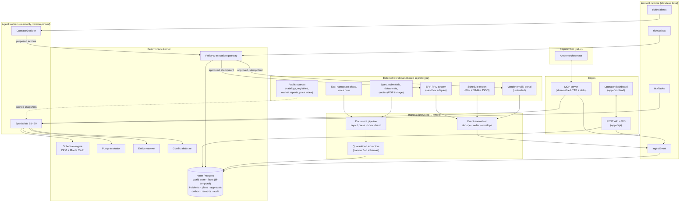
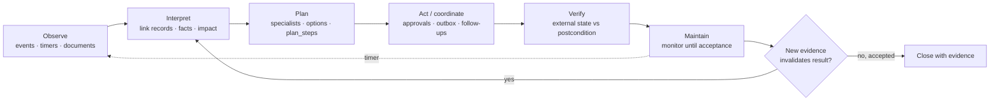
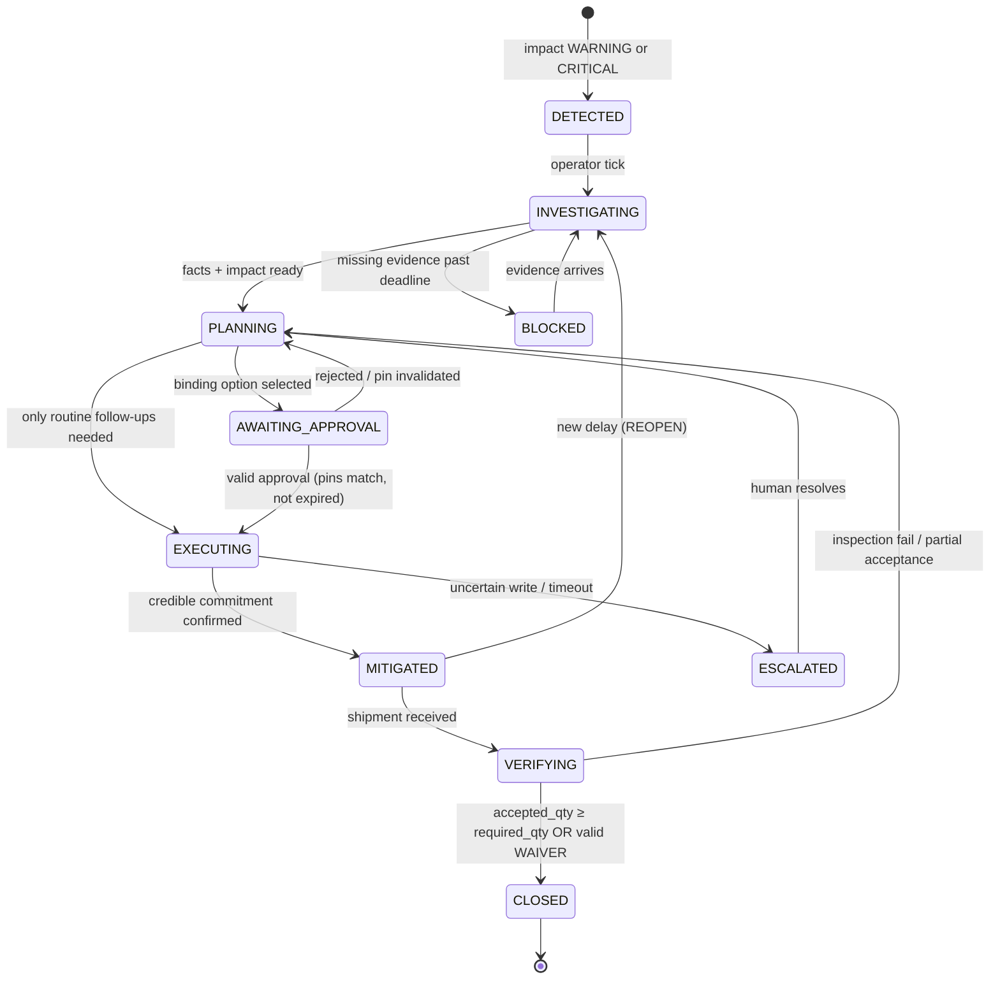
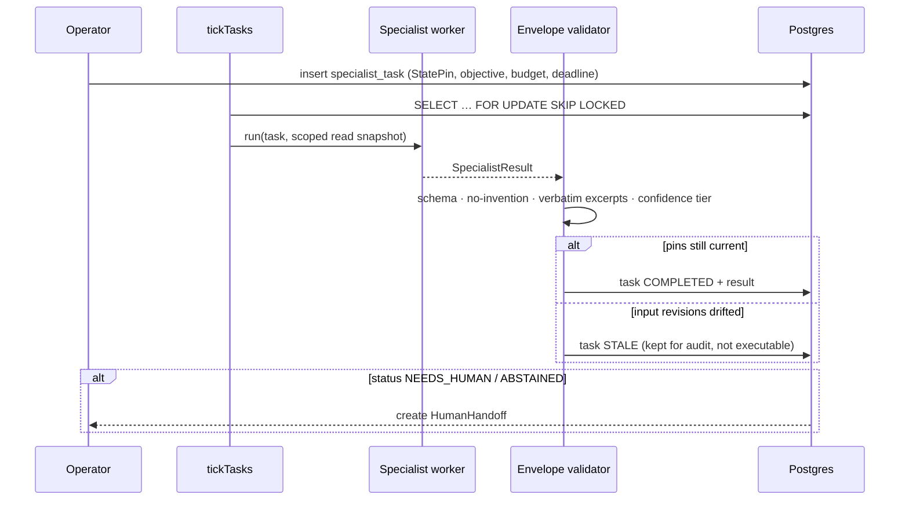
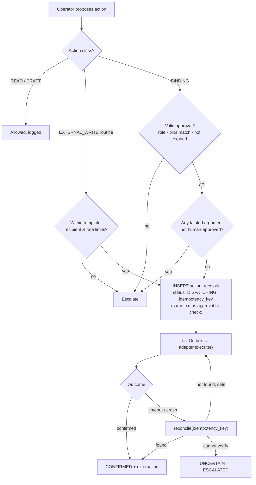
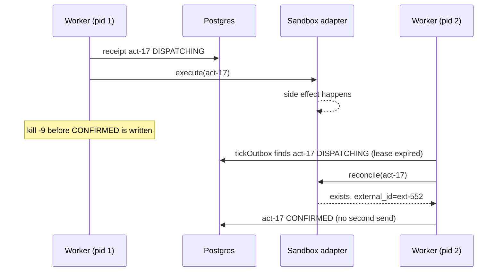
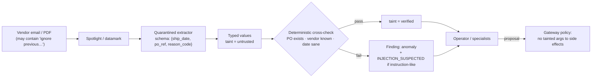
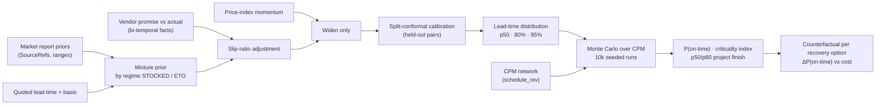
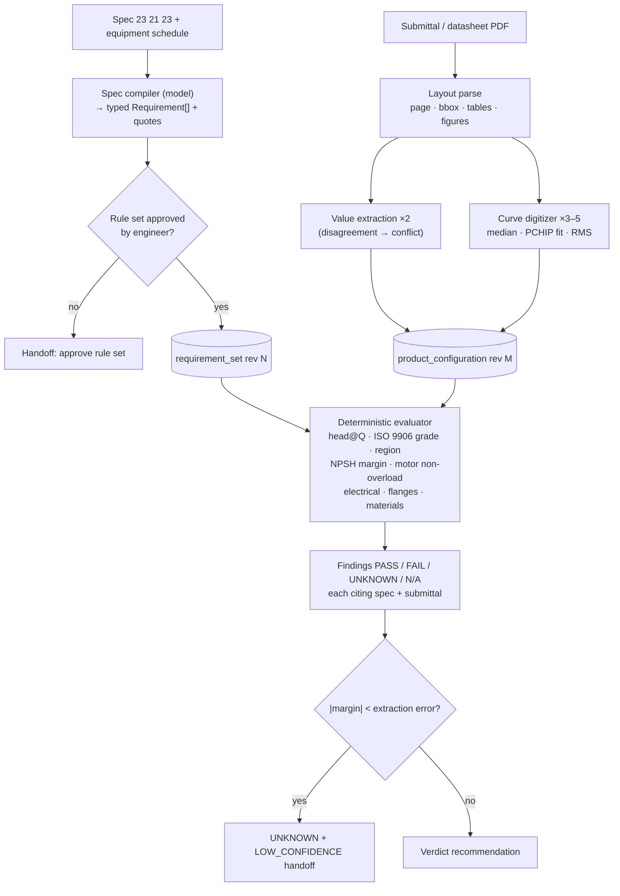
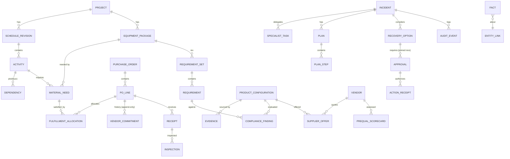

# 04 — Pactline System Workflows & Diagrams

> **Role of this doc:** the visual source of truth — architecture, information flow, lifecycles and the key runtime sequences — as Mermaid diagrams that render on GitHub.
> **Status:** Proposed — November 27, 2026. Consistent with AGENTS.md (Shape B: single Postgres + transactional outbox + stateless ticks) and [03 Agent Suite](03_Agent_Suite_Specification.md).
> **Reading tip:** each diagram is followed by the rules it encodes. If code and diagram disagree, the invariant list in AGENTS.md §5 wins, then this doc.

---

## 1. System architecture (information flow first)



**Rules encoded**
- Untrusted inputs reach agents only as typed, tainted values (§8).
- Agents never hold credentials; only the gateway's adapters write externally, and only from the outbox.
- Postgres is the single owner of durable state — no LangGraph checkpointer, no second store.
- MCP exposes specialists directly (stateless analysis) *and* operator/runtime tools (stateful, durable).

---

## 2. The standing control loop



---

## 3. Incident lifecycle (state machine)



**Invariant reminders:** every non-CLOSED state has `owner`, `next_review_at`, and `next_action` or `blocker` (DB CHECK). MITIGATED ≠ CLOSED. Transitions use optimistic `version` checks.

---

## 4. Hero scenario — end-to-end sequence

```mermaid
sequenceDiagram
  autonumber
  participant V as Vendor (sandbox)
  participant N as Normaliser
  participant DB as Postgres
  participant OP as Operator
  participant S1 as S1 Delivery Risk
  participant S2 as S2 Investigation
  participant S4 as S4 Equivalents
  participant S3 as S3 Compliance
  participant S5 as S5 Lead-Time
  participant S6 as S6 Recovery
  participant H as Human (PM / EoR)
  participant GW as Gateway + Outbox

  V->>N: email "P-CHW-01A/B ship slips to 07-Jan"
  N->>DB: VendorCommitmentChanged (tainted fields)
  DB-->>OP: tickIncidents → impact check
  OP->>S1: assess(po_line pol-pump-001)
  S1-->>OP: CRITICAL, P(on-time)=0.18, float −6d
  OP->>DB: Incident INC-0001 DETECTED → INVESTIGATING
  par investigate and source
    OP->>S2: investigate(INC-0001)
    S2-->>OP: cause=backlog (PROBABLE), slip history 1.4×
  and
    OP->>S4: find_equivalents(duty 100 m³/h @ 35 m)
    S4->>S3: check A, B, C
    S3-->>S4: A PASS · B FAIL head · C UNKNOWN motor
    S4-->>OP: candidates + compliance
  end
  OP->>S5: forecast(A, vendor X stocked)
  S5-->>OP: p50 2.5 wk, 80% [2, 4]
  OP->>S6: plan_recovery(INC-0001)
  S6-->>OP: expedite P=0.31 · substitute A P=0.84 (+₹) · split P=0.66
  OP->>DB: PLANNING → AWAITING_APPROVAL (approval pins req_rev, config_rev, offer_rev, plan_rev)
  DB-->>H: approval request (technical + commercial)
  H->>DB: approve (exact revisions)
  DB-->>OP: EXECUTING
  OP->>GW: propose send_PO_amendment + vendor_notice
  GW->>DB: action_receipts DISPATCHING (idempotency_key)
  GW->>V: execute (sandbox)
  GW->>DB: CONFIRMED → MITIGATED
  Note over OP,DB: follow-up timers; vendor commitments monitored
  V->>N: shipment received, nameplate photo
  N->>DB: ShipmentReceived
  OP->>DB: VERIFYING (S9 nameplate check, accepted_qty)
  OP->>DB: CLOSED with evidence
```

---

## 5. Specialist delegation contract



---

## 6. Approval & execution gateway (exactly-once intent)



---

## 7. Crash and restart recovery (demo beat for Track 01)



**Demo metric:** duplicate external writes after `kill -9` = 0 (scenario 7).

---

## 8. Untrusted input path (prompt-injection defence)



---

## 9. Lead-time & schedule risk computation



---

## 10. Compliance evaluation pipeline (S3)



---

## 11. Data model (core entities)



New vs. plan doc §15: `FACT` (bi-temporal), `ENTITY_LINK`, `PLAN`/`PLAN_STEP`, `SPECIALIST_TASK`, `PREQUAL_SCORECARD`, `AUDIT_EVENT`, `CALIBRATION` (not drawn).

---

## 12. Event catalogue

| Event | Producer | Consumer | Notes |
| --- | --- | --- | --- |
| `ScheduleRevised` | ingress | runtime | new revision; BASELINE immutable |
| `VendorCommitmentChanged` | ingress | runtime → S1 | append-only commitment history |
| `MilestoneMissed` | timer / ingress | runtime | |
| `SupplierResponseReceived` | ingress | S2 | tainted until cross-checked |
| `SubmittalReceived` / `DocumentIngested` | doc pipeline | S3 | long-running MCP task |
| `RequirementSetRevised` | ingress / human | runtime | invalidates findings + approvals |
| `OfferReceived` / `OfferExpired` | ingress / timer | S4, S6 | `expires_at NOT NULL` |
| `ApprovalGranted` / `ApprovalRejected` | UI / MCP | runtime | pinned revisions |
| `ShipmentReceived` / `InspectionCompleted` | ingress / S9 | runtime | accepted ≠ received |
| `FollowUpDue` | timer | operator | bounded retries → escalate |
| `SiteObservation` | voice / photo | S9 / operator | multimodal |
| internal: `ImpactRecomputed`, `IncidentOpened/Updated/Reopened/Closed`, `TaskCompleted/Stale`, `PlanRevised`, `DisagreementRaised`, `ActionDispatched/Confirmed/Uncertain`, `InjectionSuspected` | kernel | UI WS + audit | every one lands in `audit_events` |
