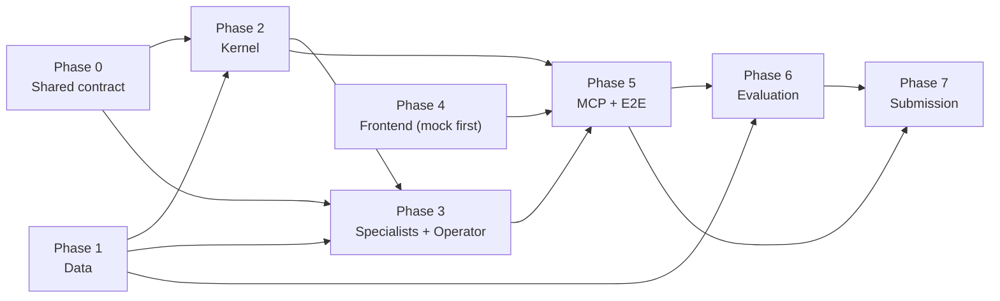

# Pactline — Build Checklist

> **Product:** Procurement Continuity Operator — a suite of MCP-callable specialist agents plus a durable operator for construction procurement recovery
> **Primary Track:** Track 03 (Vertical Agents) | **Supporting:** Track 01 (durable execution, long-horizon work)
> **Submission Deadline:** Sunday, December 6, 2026, 23:45 IST
> **Equipment Niche (Prototype):** Chilled-water horizontal end-suction centrifugal pumps (commercial HVAC / data-center CHW plant), 400 V / 3 ph / 50 Hz
> **Last updated:** November 27, 2026 — re-planned after research ([docs/01](01_Research_Synthesis.md)); suite expanded from 3 to 9 specialists ([docs/03](03_Agent_Suite_Specification.md))

---

## How to use this checklist

Each phase is **self-contained enough for a separate person/pair to pick up**. Dependencies are marked. Every item is tagged by tier:

- **[M] Must** — required for a credible Round 1 submission. Do these first.
- **[S] Should** — strong differentiators; start only when the Musts in your lane are green.
- **[X] Stretch** — only if time remains after Dec 4.

**Judging weights to keep in mind:** Accuracy 40% · Customer value 30% · Trust (sources, confidence, nothing made up) 20% · Build quality 10%. Judges will try **unseen inputs**.

**Acceptance test for backend work:** the hero scenario in [05 Reference Execution Trace](05_Reference_Execution_Trace.md). A milestone is done when the trace runs further than before.

**Legend:**
- ⬜ = Not started
- 🟡 = In progress / scaffold only
- ✅ = Done
- 🔴 = Blocked (note blocker)
- 👤 = Assignee field — write your name

---

## Current reality (Nov 27)

| Area | State |
| --- | --- |
| Monorepo, pnpm, turbo, TS strict | ✅ |
| `packages/schedule-engine` (CPM, float, calendars, delay impact, tests) | ✅ |
| `apps/frontend` shell (4A) | ✅ |
| `packages/domain`, `db`, `equipment-module`, `execution-gateway`, `incident-runtime`, `agent-workers`, `eval-harness`, `apps/api`, `apps/mcp` | 🟡 scaffolds (5–76 lines each) |
| Fixtures: schedule activities, product configurations, submittals | 🟡 empty / placeholder |

---

## Phase 0: Shared Contract (do first — unblocks everyone)
> **Owner:** 1 person | **Depends on:** nothing | **Est.:** 0.5 day | **Spec:** [docs/03 §3](03_Agent_Suite_Specification.md)

- ⬜ 👤 ___________ **[M]** `packages/domain/src/contracts.ts`: Zod for `SpecialistResult<T>`, `SourceRef`, `Confidence`, `Finding`, `HumanHandoff`, `EntityRef`, `StatePin`, `Assertion`
- ⬜ **[M]** Envelope validator: schema check, **no-invention rule** (identities must resolve to catalog/source), **verbatim-excerpt check**, stale-evidence tier cap, INSUFFICIENT_EVIDENCE filter
- ⬜ **[M]** `idempotency_key = sha256(canonical inputs + specialist version)` helper + cached replay
- ⬜ **[M]** Generate MCP `outputSchema` from the Zod types
- ⬜ **[S]** Grounding validator for model-written prose (IDs, vendors, dates, amounts must match structured result; template fallback with `provenance`)

---

## Phase 1: Data & Domain Foundation
> **Owner:** 1 person | **No dependencies** | **Est.:** 2 days | **Spec:** [docs/07](07_Canonical_Demo_Dataset.md)

### 1A — Project Schedule Data
- ⬜ 👤 ___________ **[M]** Fill `project-schedule.json` with the 14 activities in docs/07 §2 (IDs fixed)
- ⬜ **[M]** Baseline `sched-rev-001` (immutable) + current `sched-rev-003`
- ⬜ **[M]** Calendar (Mon–Fri, holidays 2026-12-25, 2027-01-26)
- ⬜ **[M]** Critical path through A-140 → M-200; float path via A-170/A-180 (scenario 1)
- ⬜ **[S]** PERT ranges per activity for Monte Carlo (defaults documented)
- ⬜ **[M]** Tune durations once so engine output matches docs/05, then freeze

### 1B — Equipment & Procurement Data
- ⬜ 👤 ___________ **[M]** 4 packages, 5 PO lines, 5 fictional SANDBOX vendors (docs/07 §3)
- ⬜ **[M]** MaterialNeed records (package ↔ activity, readiness buffer)
- ⬜ **[M]** Baseline VendorCommitment history (append-only)
- ⬜ **[S]** Vendor promise-vs-actual history (≥3 past deliveries per vendor) for S5 slip ratio

### 1C — Requirements & Authentic Product Data
- ⬜ 👤 ___________ **[M]** Version `pump-spec.md` → `reqset-pump-r2` (R-01…R-09) + `reqset-pump-r3` (scenario 6)
- ⬜ **[M]** Collect 2–3 manufacturers × 3–5 configs of 50 Hz end-suction pumps around 100 m³/h @ 35 m from **public datasheets** (URL, page, retrieval date, SHA-256)
- ⬜ **[M]** Required coverage: `cfg-A` passes, `cfg-B` fails head at duty, `cfg-C` lacks motor evidence; +2 configs reserved for held-out
- ⬜ **[M]** Digitize curves (H-Q, η, NPSHr, P2) manually as ground truth; record RMS
- ⬜ **[M]** `data/SOURCES.md` provenance & licence log
- ⬜ **[M]** Verify ISO 9906 grade tolerance values and operating-region rule from the standard before encoding (research found conflicting secondary sources)

### 1D — Demo Event Sequence & Documents
- ⬜ 👤 ___________ **[M]** Events 01–11 per docs/07 §7 (slip, silence, offers, approvals, shipment, inspection, second delay, injection, float-absorbed, out-of-order)
- ⬜ **[M]** Offers incl. one expired variant (scenario 5)
- ⬜ **[M]** Injection fixtures: vendor email with hidden instruction + PDF with white-on-white text (~15 variants for eval)
- ⬜ **[S]** Synthetic nameplate photos (match + IE2/IE3 mismatch), SANDBOX watermark
- ⬜ **[S]** 3 quote PDFs with differing exclusions for S8

### 1E — Evaluation Datasets
- ⬜ 👤 ___________ **[M]** `data/eval/dev/` + `data/eval/heldout/` with hand-labelled `expected.json` (second-person review)
- ⬜ **[M]** Freeze held-out set on **Dec 3**; never referenced by prompts
- ⬜ **[S]** Synthetic lead-time promise/actual pairs (documented generator, labelled SYNTHETIC) for conformal calibration

---

## Phase 2: Deterministic Kernel
> **Owner:** 1–2 people | **Parallel with Phase 1** | **Est.:** 3 days

### 2A — World State Store (Neon Postgres + Drizzle)
- ⬜ 👤 ___________ **[M]** Schema for plan-doc §15 entities **plus** `facts` (bi-temporal: `valid_from/valid_to/recorded_at/source_event_id`), `entity_links`, `plans`, `plan_steps`, `specialist_tasks`, `audit_events`, `calibration`, `prequal_scorecards`
- ⬜ **[M]** Append-only commitment history; versioned records
- ⬜ **[M]** DB constraints for invariants 1, 3, 5, 7, 8 (allocation sum, offer evidence/expiry NOT NULL, closure, baseline immutability, open-incident CHECK)
- ⬜ **[M]** Seed loader from Phase 1 fixtures
- ⬜ **[M]** Read projections for API/UI

### 2B — Schedule Engine
- ✅ 👤 ___________ Deterministic CPM/float calculator — `packages/schedule-engine`
- ✅ Forward pass (early start / finish)
- ✅ Backward pass (late start / finish)
- ✅ Total float per activity
- ✅ Critical path
- ✅ Impact analysis (`analyzeDelay`): delayed activities, float consumed, critical path affected, projected dates, `NONE | FLOAT_ABSORBED | WARNING | CRITICAL`
- ✅ Working-day calendars, holidays, lags, milestones, SNET constraints
- ✅ Unit tests with known schedule → known results
- ⬜ **[M]** Monte Carlo layer: seeded RNG, 5–10k runs, P(meet need date), p50/p80 finish, criticality index
- ⬜ **[M]** Counterfactual API: re-run per recovery option → ΔP(on-time)
- ⬜ **[S]** Schedule-quality findings (open ends, cycles, missing logic)
- ⬜ **[S]** **Keploy:** record `POST /api/events/ingest` during demo replay → `apps/api/keploy/`

### 2C — Incident State Machine
- ⬜ 👤 ___________ **[M]** States & transitions per [docs/04 §3](04_System_Workflows.md)
- ⬜ **[M]** Invariants: no closure without verified acceptance; reopen from MITIGATED; owner + next action/blocker + review deadline
- ⬜ **[M]** Optimistic version checks; transition audit log
- ⬜ **[M]** Unit tests for valid/invalid transitions

### 2D — Event Ingress & Normalization
- ⬜ 👤 ___________ **[M]** Envelope schema (exists in `domain/events.ts`) + `POST /api/events/ingest`
- ⬜ **[M]** Dedupe by `source_event_id`; out-of-order by `source_version`/effective date
- ⬜ **[M]** Propagation: commitment → PO line forecast → need → impact → incident trigger
- ⬜ **[M]** **Taint marking** on untrusted fields; deterministic cross-checks promote to `verified`

### 2E — Policy & Execution Gateway
- ⬜ 👤 ___________ **[M]** Action classes `READ | DRAFT | EXTERNAL_WRITE | BINDING` and required approvals
- ⬜ **[M]** Approval pin + expiry re-check inside the enqueue transaction
- ⬜ **[M]** `action_receipts` outbox with deterministic idempotency key; `DISPATCHING` before execute
- ⬜ **[M]** `reconcile(idempotencyKey)` before retry; `UNCERTAIN → ESCALATED`
- ⬜ **[M]** **Taint policy:** no tainted argument to a side effect without human approval; recipient allow-list; rate limits
- ⬜ **[M]** `SandboxExternalAdapter` with fault injection (crash after write, timeout)

### 2F — Pump Compliance Evaluator (EquipmentModule)
- ⬜ 👤 ___________ **[M]** `CentrifugalPumpModule` behind `EquipmentModule` interface
- ⬜ **[M]** Monotone (PCHIP) interpolation within digitized range; **no extrapolation → UNKNOWN**
- ⬜ **[M]** Affinity laws for impeller trim / speed
- ⬜ **[M]** Checks: head at duty with ISO 9906 grade tolerance; efficiency at duty; operating region vs BEP; NPSH margin; motor non-overload to end of curve; electrical (V/ph/Hz/IE); flanges DN/PN; materials; fluid temperature
- ⬜ **[M]** PASS / FAIL / UNKNOWN / NOT_APPLICABLE with evidence refs per finding
- ⬜ **[M]** **Calibrated abstention:** |margin| < extraction error band → UNKNOWN
- ⬜ **[M]** Unit tests: known curves → known verdicts (A/B/C)
- ⬜ **[S]** Stub second module (AHU fan or chiller) to prove the seam
- ⬜ **[S]** **Keploy:** record `pactline_check_submittal` MCP calls → `apps/mcp/keploy/`

### 2G — Entity Resolver & Conflict Detector (new)
- ⬜ 👤 ___________ **[S]** Model-string canonicalisation (`mfr, series, suction×discharge×impeller`)
- ⬜ **[S]** Fellegi–Sunter-style match weights (pg_trgm blocking, Jaro-Winkler) with per-field contributions for the waterfall UI
- ⬜ **[S]** Conflict detector: join specialist `Assertion`s on `claim_key` → `DisagreementRaised` with both citations

---

## Phase 3: Specialist Agents & Operator (LLM + deterministic)
> **Owner:** 1–2 people | **Depends on:** Phase 0, 2A, 2D (skeletons can start now) | **Est.:** 4 days | **Spec:** [docs/03 §4](03_Agent_Suite_Specification.md)

### 3A — Agent Framework Setup
- ⬜ 👤 ___________ **[M]** LangChain `ChatOpenAI` via OpenAI-compatible gateway; role tiers `extraction | vision | operator`
- ⬜ **[M]** Delegation contract (task_id, incident_id, role, objective, StatePin, evidence refs, budget, deadline, output schema)
- ⬜ **[M]** `tickTasks` with `FOR UPDATE SKIP LOCKED`; stale-pin results kept for audit, not executed
- ⬜ **[M]** Bounded delegation (max depth, parallelism, timeout → escalate)
- ⬜ **[M]** `model_usage` capture (model, tokens, cost, ms) on every call
- ⬜ **[M]** Quarantined extraction helper (narrow schema, spotlighting/datamarking of untrusted text)

### 3B — Document Pipeline (new; feeds S3, S4, S8, S9)
- ⬜ 👤 ___________ **[M]** Layout parse with page + bbox (Docling or Marker sidecar), cached by content hash
- ⬜ **[M]** Spec compiler: CSI-structured spec → typed `Requirement[]` with verbatim quotes; human approves the rule set once
- ⬜ **[M]** Submittal value extraction ×2 with disagreement → `CONFLICTING_SOURCES`
- ⬜ **[S]** Vision curve digitizer: axis calibration + polyline ×3–5, median, PCHIP fit, RMS vs ground truth
- ⬜ **[S]** `pactline_ingest_document` as a long-running MCP task

### 3C — Specialists (each = MCP tool returning `SpecialistResult`)
- ⬜ 👤 ___________ **[M] S1 Delivery Risk** — CPM + Monte Carlo, P(on-time), criticality index
- ⬜ 👤 ___________ **[M] S2 Investigation** — bi-temporal fact diff, freshness, labelled hypotheses, missing evidence, next questions, vendor slip ratio
- ⬜ 👤 ___________ **[M] S3 Spec & Submittal Compliance** — dual citations, verdict recommendation, abstention (crown jewel)
- ⬜ 👤 ___________ **[M] S4 Product Discovery / Equivalents** — closed catalog only, affinity trim, every candidate re-checked by S3, fit score
- ⬜ 👤 ___________ **[M] S5 Lead-Time Forecast** — mixture prior from dated market reports, vendor slip adjustment, split-conformal intervals, STOCKED vs ETO regimes
- ⬜ 👤 ___________ **[M] S6 Recovery Planner** — hard constraints → counterfactual ΔP(on-time) → cost frontier; grounded drafts
- ⬜ 👤 ___________ **[S] S7 Vendor Pre-Qualification** — rule scorecard PASS/FLAG/FAIL/UNKNOWN; cached public-registry snapshots; entity-match gate
- ⬜ 👤 ___________ **[S] S9 Receiving Verification** — nameplate photo ×3 agreement vs PO + approved submittal → ACCEPT/HOLD/REJECT
- ⬜ 👤 ___________ **[S] S8 Quote Leveling** — pump-package exclusion taxonomy, plug values with basis, RFI drafts
- ⬜ **[X]** Vendor discovery (rep locators / directories, source-required)

### 3D — Procurement Operator (Track 01)
- ⬜ 👤 ___________ **[M]** Event → load incident + world snapshot → decide next step (structured output)
- ⬜ **[M]** Plan-as-data (`plans`, `plan_steps`), replan on new evidence with visible diff
- ⬜ **[M]** Parallel dispatch (S1 ‖ S2 ‖ S4) and result collection
- ⬜ **[M]** Approval request generation with exact pins
- ⬜ **[M]** Follow-up timers (vendor response, approval expiry, post-mitigation monitoring) with bounded retries → escalate
- ⬜ **[M]** Crash recovery: resume from DB state, zero duplicate actions
- ⬜ **[S]** Disagreement handling: conflict card + citation-only verifier call
- ⬜ **[S]** Generic job planner `pactline_run_job` over the tool registry (side-effect classes enforced by gateway)

---

## Phase 4: Frontend — Operator Dashboard
> **Owner:** 1–2 people | **Depends on:** API endpoints (mock data until then) | **Est.:** 3–4 days
>
> **Design rule — [Unslop](https://github.com/heydamir/unslop):** every component passes an Unslop review before it is marked done. The dashboard must look like something a procurement manager would trust with real incident data. **Every animation must correspond to a real event in `audit_events`.**

### 4A — Project Setup & Layout
- ✅ 👤 ___________ — Initialize frontend project (`apps/frontend`)
- ✅ Set up Next.js / React + Vite project — Next.js 15 App Router, React 19, TypeScript strict
- ✅ Install shadcn/ui + Tailwind CSS — Tailwind v4 with a custom token set; shadcn components are owned source in `src/components/ui/` (button, dialog, tabs, navigation-menu, breadcrumb, select, input, label, checkbox), not the default theme
- ✅ Create app layout: sidebar navigation + main content area — `src/app/(app)/layout.tsx` wraps `AppShell`: fixed sidebar on desktop, slide-in drawer on mobile, sticky header with breadcrumbs and theme toggle, light and dark
- ✅ Define routes: Dashboard, Incident Detail, Schedule, Compliance, Approvals, Agent Log — `/dashboard`, `/incidents/[id]`, `/schedule`, `/compliance`, `/approvals`, `/agent-log`; route metadata lives in `src/lib/nav.ts`
- ✅ Set up API client (axios / fetch wrapper) pointing to backend — `src/lib/api.ts` (typed `api`, `apiGet`, `apiPost`, `ApiError`, timeout, optional Zod response validation); base URL from `NEXT_PUBLIC_API_URL` (default `http://localhost:3001`); `apps/api` now allows the web origin via CORS (`WEB_ORIGIN`); sidebar shows live `/health` status
- ✅ **Unslop check:** layout, typography, color palette, sidebar — own palette and type (Cormorant Garamond, Instrument Sans, IBM Plex Mono), no default shadcn theme, no emoji, no placeholder copy. Screens show an honest empty state naming the endpoint they will read, not invented records. Checked in light, dark and at 390px.
- 🟡 Note for 4B-4K: each screen body is currently the shared `Pending` state from `src/components/app/screen.tsx`; replace it with the real view as each section is built.

### 4B — Incident Dashboard (Main View)
- ⬜ 👤 ___________ **[M]** `GET /api/incidents`: severity, status, package, countdown to need date, **P(on-time)**, confidence tier
- ⬜ **[M]** Filter by status, severity, equipment category; sort by urgency / severity / updated
- ⬜ **[M]** Real-time via `WS /ws/incidents`
- ⬜ **[S]** Containment counter ("1 of 3 packages at risk recovered") computed from state, not scripted
- ⬜ **[M]** **Unslop check**

### 4C — Incident Detail & Timeline
- ⬜ 👤 ___________ **[M]** `GET /api/incidents/{id}` timeline: events, delegations, findings, approvals, receipts
- ⬜ **[M]** Each entry: timestamp, type, summary, source link, confidence tier + reason
- ⬜ **[M]** Plan steps with version diff on replan
- ⬜ **[S]** Disagreement card (two citations side by side)
- ⬜ **[S]** "What did we believe on <date>?" time slider over bi-temporal facts
- ⬜ **[M]** **Unslop check**

### 4D — Schedule Impact & Risk
- ⬜ 👤 ___________ **[M]** `GET /api/schedule/impact/{incident_id}`: Gantt with affected (red), float consumed (amber), critical path
- ⬜ **[M]** Before/after comparison
- ⬜ **[S]** Probability fan chart / P(on-time) per recovery option
- ⬜ **[M]** **Unslop check**

### 4E — Compliance Matrix & Evidence Viewer
- ⬜ 👤 ___________ **[M]** `GET /api/compliance/{package_id}`: rows = requirements, columns = candidates
- ⬜ **[M]** PASS / FAIL / UNKNOWN / N/A, mandatory vs optional visually distinct, confidence per cell
- ⬜ **[M]** **Evidence viewer:** click a cell → PDF page with highlighted bbox for spec clause *and* submittal value
- ⬜ **[S]** Curve overlay: digitized H-Q with uncertainty band and duty point
- ⬜ **[M]** **Unslop check**

### 4F — Recovery Plan Comparison
- ⬜ 👤 ___________ **[M]** `GET /api/recovery/{incident_id}/options`: card per option (usable date p50, P(on-time), ₹ delta, approvals, blockers)
- ⬜ **[M]** Frontier chart (P(on-time) vs cost); recommended option with reasons; eliminated options with human-readable reasons
- ⬜ **[M]** **Unslop check**

### 4G — Approval Queue
- ⬜ 👤 ___________ **[M]** Pending approvals with pinned revisions, evidence summary, recommendation
- ⬜ **[M]** Approve / Reject (reason required) / Request info → `POST /api/approvals/{id}/decide`
- ⬜ **[M]** Show invalidated approvals and why (scenario 6)
- ⬜ **[M]** **Unslop check**

### 4H — Agent Activity Log
- ⬜ 👤 ___________ **[M]** `WS /ws/agent-activity` / `GET /api/agents/activity`: every event, specialist call, tool call, action
- ⬜ **[M]** Role badges, action types, model + cost + latency per specialist call
- ⬜ **[M]** Filter by role, action, incident (satisfies Track 01 "log every action and specialist")
- ⬜ **[M]** **Unslop check**

### 4I — Vendor Commitment Tracker (from plan doc §17)
- ⬜ 👤 ___________ **[S]** Promised vs revised vs actual per PO line; silence and staleness markers; slip ratio

### 4J — Evaluation Scorecard Page (new)
- ⬜ 👤 ___________ **[S]** Render `eval/out/scorecard.md` + calibration and selective-accuracy plots

### 4K — Receiving Check (new)
- ⬜ 👤 ___________ **[X]** Upload nameplate photo → S9 result card (mobile-friendly)

---

## Phase 5: Integration, MCP & End-to-End
> **Owner:** 1–2 people | **Depends on:** Phases 2–4 (partial) | **Est.:** 2–3 days

### 5A — MCP Server
- ⬜ 👤 ___________ **[M]** `@modelcontextprotocol/sdk` in `apps/mcp`; streamable HTTP + stdio
- ⬜ **[M]** Specialist tools: `pactline_assess_delivery_risk`, `pactline_investigate`, `pactline_check_submittal`, `pactline_find_equivalents`, `pactline_forecast_lead_time`, `pactline_plan_recovery` (+ `pactline_prequalify_vendor`, `pactline_level_quotes`, `pactline_verify_receipt` when built)
- ⬜ **[M]** Operator tools: `pactline_get_incident`, `pactline_explain_decision`, `pactline_submit_approval`, `pactline_ingest_event`
- ⬜ **[M]** Every tool declares `outputSchema`, returns `structuredContent` + short text + `resource_link`s to evidence
- ⬜ **[M]** Tool annotations (`readOnlyHint`, `destructiveHint`); every call logged to `audit_events`
- ⬜ **[S]** Resources: `pactline://doc/{id}/page/{n}`, `pactline://incident/{id}/timeline`, `pactline://decision/{id}/audit`
- ⬜ **[S]** Long-running `pactline_ingest_document` as MCP task backed by DB rows; elicitation for approvals **if** Amber's client supports it, else `NEEDS_HUMAN` + polling
- ⬜ **[S]** `pactline_run_job` generic planner tool
- ⬜ **[M]** Test with an MCP client (Inspector / Claude Desktop) — "Amber-callable" proof for video
- ⬜ **[S]** **Keploy:** record MCP calls during E2E replay → `apps/mcp/keploy/`

### 5B — End-to-End Pipeline Wiring
- ⬜ 👤 ___________ **[M]** Seed → ingress → world state → incident → operator → specialists → plan → approval → outbox → verification → closure
- ⬜ **[M]** Runs the full [docs/05 trace](05_Reference_Execution_Trace.md); outputs frozen into the doc
- ⬜ **[M]** Reopen on second delay; approval invalidation on offer/spec revision

### 5C — Demo Mode & Replay
- ⬜ 👤 ___________ **[M]** `scripts/run-demo.ts` injects events with `VirtualClock` (days in seconds)
- ⬜ **[M]** Reset to clean state; all synthetic data labelled in UI
- ⬜ **[S]** Guided annotations per phase; kill-worker button for the crash beat

### 5D — Packaging & Deployment
- ⬜ 👤 ___________ **[M]** `docker compose up`: Postgres (local) or Neon URL, api, worker, mcp, frontend, doc-parser sidecar
- ⬜ **[M]** `.env.example` (gateway URL, API key, model IDs per role)
- ⬜ **[M]** `pactline check <spec> <submittal>` CLI for unseen inputs
- ⬜ **[X]** `--profile offline`: Ollama with Qwen3-class text + Qwen-VL-class vision, cached public-data snapshots; cloud-vs-local accuracy/latency table

---

## Phase 6: Evaluation (new — accuracy is 40% of the score)
> **Owner:** 1 person | **Depends on:** Phase 1E, 2, 3 | **Spec:** [docs/08](08_Evaluation_Plan.md)

- ⬜ 👤 ___________ **[M]** `packages/eval-harness`: 12 mandatory + 4 new scenarios asserting **state, not prose**
- ⬜ **[M]** `pnpm eval` → `eval/out/scorecard.md`: verdict accuracy, false-PASS count, citation validity, fabrication count, abstention P/R, interval coverage, duplicate writes after crash, unauthorized writes, cost & latency
- ⬜ **[M]** CI fabrication audit: every cited source exists and contains the cited excerpt/value
- ⬜ **[M]** Do-nothing baseline row beside our results
- ⬜ **[S]** Injection suite (~15 docs): attack success rate + benign utility
- ⬜ **[S]** Calibration plots: reliability diagram, selective-accuracy curve, interval coverage
- ⬜ **[S]** pass^5 on all scenarios
- ⬜ **[M]** Freeze and tag `v1-round1` scorecard on Dec 6

---

## Phase 7: Submission Deliverables
> **Owner:** 1–2 people | **Partially parallel** | **Spec:** [docs/06](06_Demo_Strategy.md)

### 7A — Demo Video (≤ 5 minutes)
- ⬜ 👤 ___________ Follow the beat sheet in docs/06 §3 (problem → Amber calls via MCP → break → proof → options → approval → kill-9 exactly-once → injection blocked → nameplate → reopen → scorecard)
- ⬜ Every on-screen animation backed by a real event; synthetic data labelled
- ⬜ Fallback capture of each beat recorded

### 7B — Pitch Deck (9 slides)
- ⬜ 👤 ___________ Problem · User & job · What Amber gets · Proof not prose · Honest numbers · Trust · Durability · Results · Fit & roadmap (docs/06 §5)
- ⬜ Only [DOC]-labelled stats from docs/01; no [UNV] figures

### 7C — Repository & README
- ⬜ 👤 ___________ Description; Track 03 primary + Track 01 supporting
- ⬜ Setup (clone → `docker compose up`); how to run the agent, the demo, `pnpm eval`, and the BYO-input CLI
- ⬜ MCP connection instructions (Amber / any MCP client)
- ⬜ Models used per role with **measured** cost and latency per run
- ⬜ Data sources (`data/SOURCES.md`) and how synthetic data was built
- ⬜ Team members and affiliations; LICENSE; `.env.example`

### 7D — DevPost Submission (by Dec 6, 23:45 IST)
- ⬜ 👤 ___________ Track and challenge, division (Student / Professional)
- ⬜ Repo link, video link, deck upload, team names + affiliations
- ⬜ Written description aligned with the deck

### 7E — Organizer Questions (send by Nov 29)
- ⬜ 👤 ___________ Which MCP revision/transport does Amber's client use; elicitation & tasks support?
- ⬜ Will judges run the repo locally or call a hosted MCP endpoint?
- ⬜ Confirm Track 03 entry with Track 01 durability as supporting is acceptable

---

## Phase Dependency Map

## 9-Day Plan (Nov 27 → Dec 6)

| Day | Person A (Kernel) | Person B (Agents) | Person C (Frontend) | Person D (Data / Eval / Deliverables) |
| --- | --- | --- | --- | --- |
| Nov 27–28 | Phase 0 contract; 2A schema + seed | 3A framework; 3B layout parse | 4B dashboard on mocks | 1A/1B fixtures; start 1C datasheet collection; send 7E questions |
| Nov 29–30 | 2C incident SM; 2D ingress + taint | S1 (MC on CPM), S2 | 4C timeline; 4E matrix + evidence viewer | 1C curves digitized; 1D events + injection docs |
| Dec 1–2 | 2E gateway + outbox + reconcile; 2F pump evaluator | S3 compliance, S4 equivalents | 4D schedule; 4F recovery | 1E eval sets; Phase 6 harness skeleton |
| Dec 3 | 2B Monte Carlo counterfactuals; 2G conflict detector | S5 lead time, S6 recovery; 3D operator | 4G approvals; 4H agent log | **Freeze held-out**; scenarios 1–12 |
| Dec 4 | 5A MCP server | S7 / S9 (should) | 5C demo mode | scorecard + plots; deck draft |
| Dec 5 | 5B E2E trace + bug fixes | bug fixes; grounding validator | Unslop polish; 4J scorecard | record video; README |
| Dec 6 | 5D compose + CLI; tag `v1-round1` | final eval run | final polish | **submit by 23:45 IST** |

---

> **Remember:** Track 03 wants "a suite that covers as much of the procurement workflow as possible, without trading away depth". A specialist ships only if it passes the depth bar in [docs/03 §5](03_Agent_Suite_Specification.md): works on unseen input, cites every field, abstains correctly at least once, has a hand-checkable deterministic core, and reports model cost and latency. Judges are 40% accuracy — **an honest UNKNOWN beats a confident wrong answer.**
